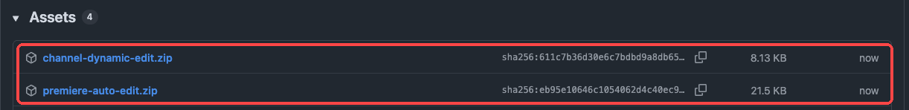
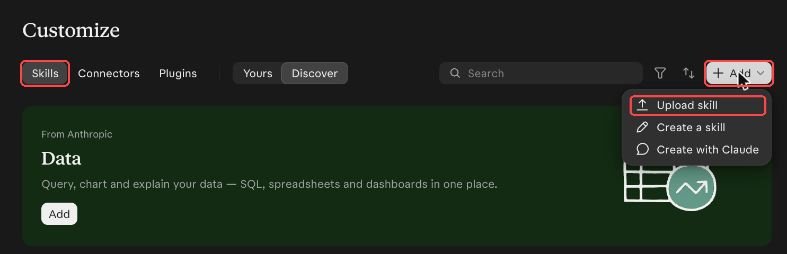

# Claude-ით ვიდეოს მონტაჟი: სქილები Premiere Pro-სთვის

🇬🇧 [English](README.md)

ორი სქილი, რომლებითაც Claude თავად ამონტაჟებს ვიდეოს Adobe Premiere Pro-ში: ჭრა, ხმა, ფერი, სუბტიტრები, ზუმები, ანიმაციები, ექსპორტი.

| სქილი | რას აკეთებს |
|---|---|
| **premiere-auto-edit** | ძირითადი სქილი: ზედმეტი დუბლების და სიჩუმის ამოჭრა, ხმის დონე, ფერი, სუბტიტრები (ElevenLabs Scribe), split-screen დემოები, ზუმები, ანიმაციები (After Effects + Remotion), პირადი ინფორმაციის დაბლარვა, ხმოვანი ეფექტები, ფაილების დალაგება, ექსპორტი |
| **channel-dynamic-edit** | დამატება YouTube-ის ვიდეოებისთვის: დინამიკური მონტაჟი (სახე ↔ split-screen), ეკრანის ჩანაწერიანი გრძელი ვიდეოები, შორთების ამოჭრა გრძელი ვიდეოდან |

## ⬇️ ჩამოტვირთვა

გადადი **[Releases](../../releases/latest)** გვერდზე და ჩამოტვირთე:
- `premiere-auto-edit.zip`
- `channel-dynamic-edit.zip`

(Git-ის ცოდნა არ გჭირდება.)



## 🧰 რა გჭირდება

- Claude-ის ფასიანი გამოწერა (Pro ან მეტი) და **Claude Desktop** აპლიკაცია
- **Adobe Premiere Pro** და **After Effects**
- **Node.js 20+** და **ffmpeg**
- **ElevenLabs** ანგარიში და API key (სუბტიტრებისთვის)
- სურვილისამებრ: **Claude in Chrome** ექსთენშენი (მაგ. Google Photos-იდან ვიდეოების ჩამოსატვირთად)

## ⚙️ დაყენება

**1. სქილების ატვირთვა.** Claude-ში (claude.ai ან Claude Desktop) მარცხენა მენიუში გახსენი **Customize → Skills**, დააჭირე **+ Add → Upload skill** და ატვირთე `premiere-auto-edit.zip`. იგივე გაიმეორე `channel-dynamic-edit.zip`-ისთვის. zip-ის გახსნა არ არის საჭირო.



Claude Code-ის მომხმარებლებისთვის: ფოლდერები ჩააგდე `~/.claude/skills/`-ში.

**2. Premiere Pro-ს დაკავშირება (MCP).** ტერმინალში გაუშვი:
```bash
npm install -g adobe-premiere-pro-mcp
premiere-pro-mcp --install-cep
```
შემდეგ Premiere-ში: **Window → Extensions → MCP Bridge → Start Bridge**.

**3. სამუშაო ფოლდერი.** შექმენი ერთი ფოლდერი მონტაჟისთვის (მაგ. `Video Editing`) და Claude Desktop-ში ჩატის **+** მენიუდან დაამატე (**Add folder**).

**4. ElevenLabs key.** ამ ფოლდერში შექმენი ფაილი `_tools/transcribe/elevenlabs.key` და შიგნით ჩასვი შენი API key. ⚠️ ეს ფაილი არავის გაუზიარო.

**5. პირველი მონტაჟი.** ჩააგდე ვიდეო ფოლდერში და Claude-ს მისწერე, მაგალითად:
> დაამონტაჟე ეს ვიდეო Premiere-ში

პირველად Claude რამდენიმე კითხვას დაგისვამს (ენა, ფერები, სუბტიტრების სტილი, არხის სახელი), პასუხებს შეინახავს და სქილს შენს სტილზე მოარგებს. საჭირო დამხმარე სკრიპტებს თავად შექმნის.

## 🔐 ნებართვები

Claude ნებართვას გკითხავს, სანამ:
- შენს ფოლდერს წაიკითხავს ან მასში ჩაწერს;
- დროებით ფაილებს წაშლის (მხოლოდ იმას, რაც თავად შექმნა);
- Premiere Pro-ს და After Effects-ს მართავს (მაუსი/კლავიატურა). ამ დროს მაუსს ნუ შეეხები.

API key-ებს ის არასდროს აჩვენებს და ვიდეოებში დაფარავს პირად ინფორმაციას (მეილები, ტოკენები, ტელეფონის ნომრები).

## 💡 რჩევები

- ყოველ შენიშვნას, რასაც Claude-ს ეუბნები („ტექსტი სახეს ფარავს“, „სუბტიტრები შუაში“), სთხოვე, რომ სქილში ჩაწეროს. ასე ისწავლის შენს სტილს.
- სქილები ინგლისურადაა დაწერილი (Claude ასე უკეთ კითხულობს), პასუხს კი შენს ენაზე გაძლევს.
- თუ სადმე გაიჭედე, დაწერე Facebook ჯგუფში.

---

## 🎓 სრული კურსი მალე

ეს არის საბაზისო ვერსია. ვამზადებ სრულ კურსს Claude-ით ვიდეოს მონტაჟზე, Premiere Pro-ზე გაცილებით მეტით. სიახლეების მისაღებად შემოუერთდი ჯგუფს: **[ისწავლე ზურასთან ერთად](https://www.facebook.com/groups/811918554954932)**

YouTube: [@learnwithzura](https://www.youtube.com/@learnwithzura)
