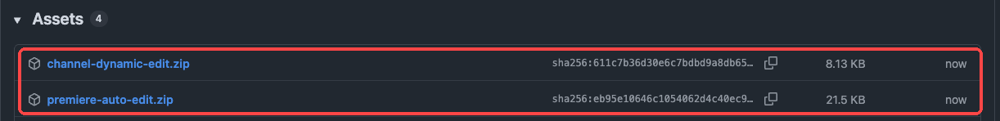
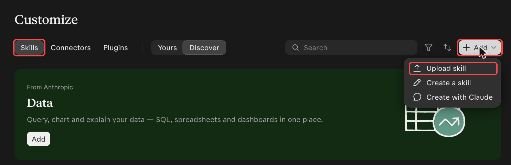

Your project is excellent,
# Video editing skills for Claude (Premiere Pro)

🇬🇪 [ქართულად](README.ka.md)

Two skills that let Claude edit talking-head and screen-recorded videos in Adobe Premiere Pro, with no manual work from you.

- **premiere-auto-edit**: the main skill. Cuts, audio, colour, transcript (ElevenLabs Scribe), captions, split-screen demos, zooms, animations (After Effects + Remotion), privacy blur, sound effects, organizing files, preview and export.
- **channel-dynamic-edit**: an add-on for YouTube channel videos. Importing a recording day, dynamic face/split layouts, real screen demos, long screen + camera videos, and cutting shorts from a long video.

## Download
Go to **[Releases](../../releases/latest)** and download `premiere-auto-edit.zip` and `channel-dynamic-edit.zip`. No git needed.

## Requirements
- A paid Claude plan and the Claude desktop app (with your editing folder connected)
- Adobe Premiere Pro + After Effects
- The Premiere Pro MCP bridge (Node.js 20+): `npm install -g adobe-premiere-pro-mcp`, then `premiere-pro-mcp --install-cep`, then in Premiere: Window > Extensions > MCP Bridge > Start Bridge
- ffmpeg
- An ElevenLabs API key (for transcripts). Put it in `_tools/transcribe/elevenlabs.key` yourself and never share that file.
- Optional: the Claude in Chrome extension (to download recordings from Google Photos or to capture product screens)

## Setup
1. In Claude (claude.ai or the desktop app) open **Customize → Skills → + Add → Upload skill** and upload each zip separately (no need to unzip). In Claude Code, copy the folders into `~/.claude/skills/` instead.

   
2. Connect your editing folder in the Claude desktop app.
3. On the first edit Claude asks a few questions once (language, colours, caption style, channel handle) and saves the answers to `_tools/edit-config.json`. It creates any missing helper scripts itself.
4. Claude asks permission before it reads your folder, deletes temporary files or controls Premiere Pro and After Effects. Approve when you are ready, and keep your hands off the mouse while it controls the apps.

## Tips
- Every time you correct something ("the text covers my face", "captions in the middle"), ask Claude to add it to the skill. That's how it learns your style.
- The skills are written in English, and Claude replies in your language.

---

A full course on video editing with Claude is coming. Join the group for updates: [Learn with Zura](https://www.facebook.com/groups/811918554954932) · YouTube: [@learnwithzura](https://www.youtube.com/@learnwithzura)
